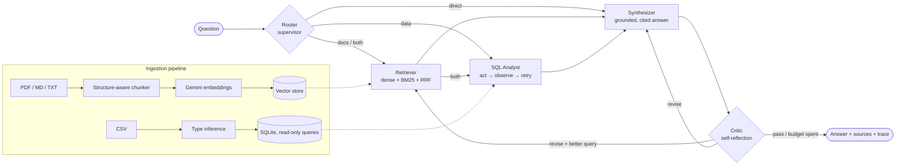

# Enterprise Knowledge Agent

A production-style **multi-agent RAG system** that answers questions over a company's **unstructured documents** (PDF, Markdown, text) **and structured data** (CSV → SQL), built with **LangGraph** and **Google Gemini**, deployable to **Google Cloud Run** with **Vertex AI**.

A supervisor agent delegates each question to specialist agents. A retriever does hybrid vector + keyword search, a SQL analyst computes over tables, a synthesizer writes a cited answer, and a critic agent self-reflects on it. The critic can send the draft back or trigger a new retrieval. Every request is traced with LLM-native metrics: latency, tokens/sec, tokens and cost per request.

```text
Q: What is the Orion-D warranty, and how many Orion-D support tickets are still open?

A: Orion-D includes a 3-year limited hardware warranty [1]. There are currently
   7 open Orion-D support tickets [SQL].

   route=both  steps=router:both -> retriever -> sql_analyst:ok -> synthesizer -> critic:pass -> finalize
```

## Architecture



| Agent | Responsibility | Pattern |
|---|---|---|
| **Router** | Classifies the question (`docs`, `data`, `both`, `direct`) and rewrites it into a standalone search query | Hierarchical delegation (supervisor) |
| **Retriever** | Hybrid search: dense embeddings + BM25, fused with Reciprocal Rank Fusion | Hybrid RAG |
| **SQL Analyst** | Writes SQLite, executes it, feeds errors back to the model and retries | Tool-use loop (act → observe → retry) |
| **Synthesizer** | Answers only from context and cites every claim (`[1]`, `[SQL]`) | Grounded generation |
| **Critic** | Checks grounding, citations and relevance; can request a rewrite or a new retrieval | Self-reflection / corrective RAG |

## Features

- **Structured + unstructured data.** PDFs/Markdown are chunked by section and embedded. CSVs are loaded into SQLite with inferred column types, so the agent can do real aggregation instead of guessing numbers from text.
- **Hybrid retrieval.** Dense vectors catch paraphrases ("time off" ≈ "leave"), and BM25 catches exact terms (policy codes, product names, numbers). RRF merges the two rankings without score calibration.
- **Safe text-to-SQL.** LLM-written SQL is treated as untrusted. It passes a static single-`SELECT` check, a SQLite **authorizer** that denies every non-read operation, a query **timeout** and a row limit.
- **Self-correcting.** The critic loop has a bounded revision budget (`MAX_REVISIONS`), so quality improves without risking infinite loops.
- **Observability.** Per-request traces with spans for every agent step, plus per-call tokens, latency and cost, written to JSONL. `/metrics` reports p50/p95 latency, tokens/sec and average cost per request.
- **Evaluation harness.** Route accuracy, retrieval hit rate, answer keyword recall, optional LLM-as-judge groundedness, latency and cost. The output is a Markdown report.
- **Production API.** FastAPI with API-key auth (constant-time compare), upload validation (type allowlist, size limit, filename sanitizing), and a minimal web UI.
- **Pluggable backends.** Local persistent NumPy vector store or ChromaDB, Gemini via API key or Vertex AI, and an offline `mock` provider so everything runs and is tested without credentials.
- **Cloud-ready.** Dockerfile (non-root), a Cloud Run deploy script with a least-privilege service account and Secret Manager, and GitHub Actions CI.

## Quick start

```bash
python -m venv .venv
# Windows: .venv\Scripts\activate    macOS/Linux: source .venv/bin/activate
pip install -r requirements-dev.txt
cp .env.example .env                 # then set GOOGLE_API_KEY (or LLM_PROVIDER=mock to run offline)
```

Ingest the sample company data (5 policy/FAQ documents and 2 tables for a fictional robotics company):

```bash
python -m app.cli ingest sample_data --reset
```

Ask questions:

```bash
python -m app.cli ask "How many days of parental leave does a secondary caregiver get?"
python -m app.cli ask "Which region had the highest total revenue in 2026-Q3?"
python -m app.cli ask "What is the Orion-D warranty, and how many Orion-D tickets are still open?"
```

Run the API and web UI:

```bash
uvicorn app.api:app --reload
# open http://localhost:8000  ·  API docs at http://localhost:8000/docs
```

### Using Gemini

| Option | Settings |
|---|---|
| Gemini API key ([AI Studio](https://aistudio.google.com/apikey)) | `LLM_PROVIDER=gemini`, `GOOGLE_API_KEY=...` |
| Vertex AI on GCP | `LLM_PROVIDER=gemini`, `USE_VERTEX_AI=true`, `GCP_PROJECT=...`, then `gcloud auth application-default login` |

Changing `EMBEDDING_MODEL` or `EMBEDDING_DIM` changes the vector space, so re-ingest with `--reset` afterwards.

## API

| Method | Path | Description |
|---|---|---|
| `GET` | `/health` | Liveness check (no auth) |
| `POST` | `/ask` | `{"question": "..."}` returns answer, route, sources, SQL, agent steps, metrics and trace |
| `POST` | `/ingest` | Multipart upload of `.pdf/.md/.txt/.csv` files |
| `GET` | `/stats` | Indexed chunk count, tables, model |
| `GET` | `/metrics` | p50/p95 latency, tokens/sec, avg tokens and cost per request |
| `DELETE` | `/index` | Clear documents and tables |

If `API_KEY` is set, every endpoint except `/health` requires the header `X-API-Key`.

```bash
curl -s -X POST localhost:8000/ask -H "Content-Type: application/json" \
  -d '{"question": "What is the hotel limit in London?"}'
```

## Evaluation

```bash
python -m app.cli eval            # route accuracy, retrieval hit rate, keyword recall, latency, cost
python -m app.cli eval --judge    # + LLM-as-judge groundedness (uses extra tokens)
```

[`evals/dataset.jsonl`](evals/dataset.jsonl) has 16 labelled cases across document, data and mixed questions. Each run writes a Markdown report to `evals/results/`.

> The numbers from `LLM_PROVIDER=mock` only show that the pipeline works end to end. Run with Gemini to get real quality, latency and cost figures.

## Deploy to Google Cloud Run

```bash
PROJECT_ID=your-project API_KEY=$(openssl rand -hex 24) ./deploy/cloudrun.sh
```

The script enables the required APIs, creates a least-privilege service account (`roles/aiplatform.user`), stores the API key in Secret Manager, and deploys from source with Vertex AI enabled. Cloud Run's filesystem is ephemeral, so the container re-ingests `sample_data/` on startup (`SEED_DIR`). For persistent production data, point the vector store at a managed database (see Roadmap).

## Tests

```bash
pytest          # 48 tests, fully offline
ruff check app tests
```

The tests cover chunking, hybrid retrieval and persistence, SQL safety guards (write attempts, multi-statement injection, runaway queries), every graph path (routing, SQL retry with error feedback, corrective retrieval, revision budget, fallbacks), tracing and cost maths, API auth and upload validation, and an end-to-end ingest → ask → eval run.

## Project layout

```text
app/
  agents/graph.py      LangGraph state machine: router, retriever, SQL analyst, synthesizer, critic
  agents/prompts.py    All agent prompts
  ingest/              Loaders (PDF/MD/TXT) and structure-aware chunker
  retrieval/           Vector stores (local NumPy, Chroma) and hybrid BM25 + dense retriever
  data/sql_store.py    CSV → SQLite with read-only, sandboxed query execution
  llm.py               Gemini client (API key / Vertex AI), offline mock, tracing wrapper
  tracing.py           Spans, token/cost accounting, metrics registry
  service.py           Wires everything together (ingest, ask)
  api.py               FastAPI service + web UI
  evals.py, cli.py     Evaluation harness and CLI
evals/dataset.jsonl    Labelled evaluation set
sample_data/           Fictional company documents and tables
deploy/cloudrun.sh     Cloud Run deployment
tests/                 Offline test suite
```

## Design decisions

- **LangGraph over a hand-rolled loop.** The control flow (conditional routing, loops back from the critic) is explicit, inspectable and easy to extend with new specialist agents.
- **SQL for numbers, RAG for prose.** Embedding a CSV and asking an LLM to add up rows is unreliable. Routing quantitative questions to SQL gives exact answers that can be checked.
- **Bounded self-reflection.** The critic improves answers, but every extra pass costs tokens and latency. `MAX_REVISIONS` caps it, and the metrics show the cost.
- **A mock provider as a first-class backend.** Deterministic, credential-free runs make the test suite fast and let CI exercise the full graph.

## Roadmap

- Managed vector store for production (AlloyDB/Cloud SQL with pgvector, or Vertex AI Vector Search)
- Conversation memory with a LangGraph checkpointer
- OpenTelemetry export to Cloud Trace
- Streaming responses
- Reranking stage (cross-encoder or Vertex AI ranking API)

## License

MIT
